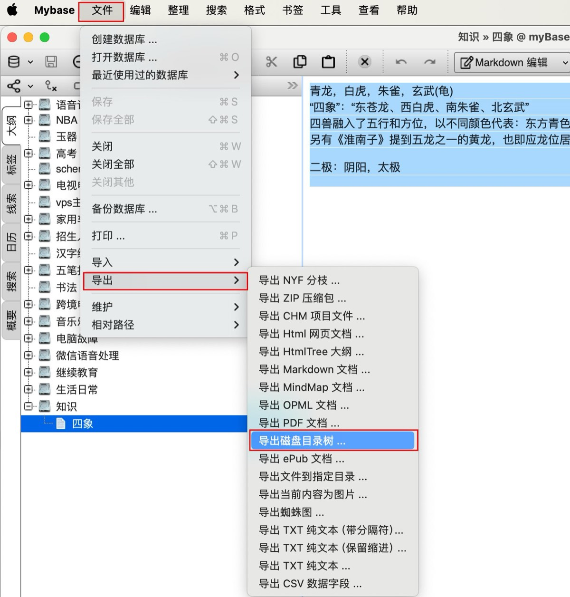
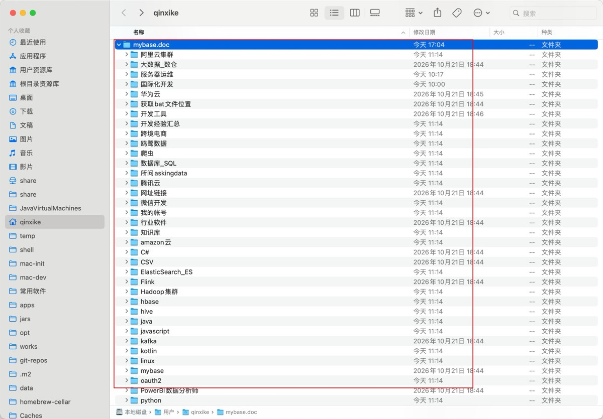
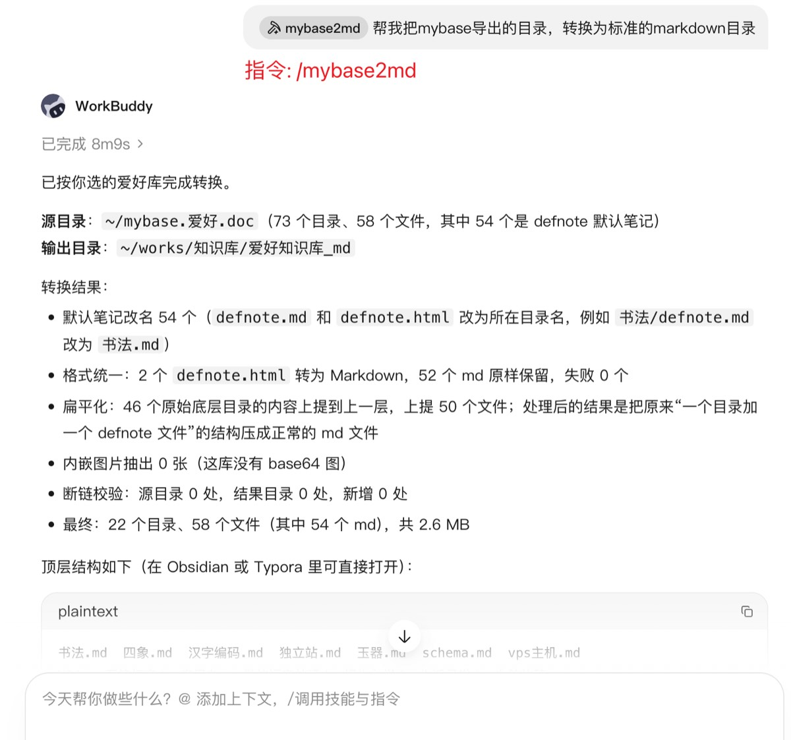
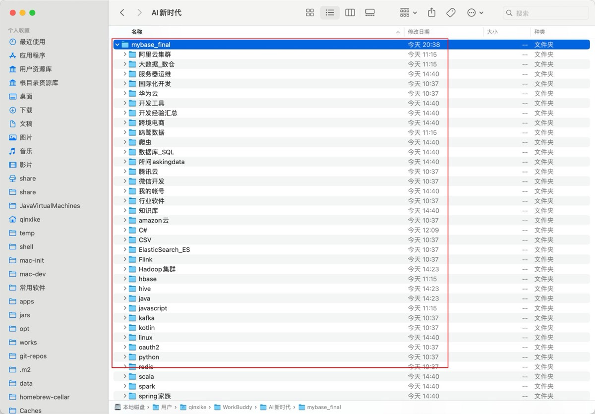

# 我把 1282 个文件夹的 myBase 笔记库变成了标准 Markdown 库，还上架成了技能

> 作者：qinxike · 2026-11 · 全文约 15 分钟
> 关键词：myBase、Markdown、Obsidian、Python、WorkBuddy Skill、技能市场上架

用了多年 myBase 存笔记，想迁移到 Obsidian 的时候才发现：myBase 的「导出磁盘目录树」给出的东西，并不是一个能直接用的 Markdown 库。本文记录我如何从一份 1038 行的 Python 脚本开始，把它打磨成一个跨平台、带弹窗交互、能自检环境的 WorkBuddy 技能（mybase2md），最后打包上架到技能市场的全过程——包括踩过的每一个坑。

**先看结果：**

| 指标 | 改造前 | 改造后 |
|---|---|---|
| 目录数 | 1282 | 252（含根） |
| 文件数 | 1270 | 1269（1 张重复图按 MD5 合并） |
| defnote 改名 | — | 1186 个 |
| html → md 转换 | — | 239/239 成功 |
| base64 内嵌图抽出 | — | 280 张 |
| 图片断链 | 6 处 | 6 处（全部为源数据遗留，**0 新增**） |
| 文件在 3 层以内 | 最深 5 层 | **98%** |

---

## 一、myBase 导出的目录树，到底哪里不对劲

在 myBase 里，操作路径是「文件 → 导出 → 导出磁盘目录树」：



导出后的结构是这样的——每个目录就是一篇笔记：



打开任何一个目录，你会看到三类东西：

1. **一个默认名文件**：`defnote.md`、`defnote.txt`、`defnote.html` 或 `defnote.qrich.html`，对应这篇笔记正文的 4 种内容类型。「一篇笔记 = 一个目录 + 一个默认名文件 + n 个图片附件」；
2. **图片附件**：和正文同级躺在同一个目录里；
3. **子目录**：也就是子笔记，一层套一层，最深能到 5 层。

问题就出在这里：用 Obsidian / Typora 打开，满屏都是 `defnote`，根本分不清哪篇是哪篇；html 类笔记 Markdown 工具读不了；部分网页剪藏的图片以 base64 内嵌在 html 里，库会越涨越大；而 myBase 导出时没下载下来的图，会留下断链。

## 二、先把需求写成 4 条硬规则

动手之前，我把需求固化成 4 条可验收的规则，后面所有代码都围绕它们展开：

1. **改名**：`defnote.*` 统一改成所在目录的名字（保留原后缀）；
2. **转格式**：`defnote.txt` 直接改后缀为 `.md`；`defnote.html`（含 `.qrich.html`）用转换库转成同名 `.md`，**图片引用路径保持不变**；
3. **抽图**：html 里 base64 内嵌的图片，解码抽出为同目录图片文件，并改写为相对引用；
4. **扁平化（最难的一条）**：只把「**原始**底层目录」（处理前就没有子目录的目录）的内容上提到父级并删除该目录；**因扁平化而被动变成底层目录的上级目录，必须保持原样**。

外加两条全局约束：**源目录全程只读**（所有结果写到新目录，绝不原地修改）；**断链校验要区分「原有断链」和「新增断链」**——工具不能把源数据的历史问题算在自己头上。

## 三、几个关键设计

### 3.1 「原始底层目录」必须先拍快照

规则 4 的陷阱在于：如果你一边展平一边判断「这是不是底层目录」，展平动作会改变目录树本身，导致判定失真。所以第一步是把整棵树扫描成快照：

```python
# 处理前先拍快照：这 1028 个目录才是"真正的"原始底层目录
snapshot_leaf_dirs = {
    d for d, subs, files in os.walk(src)
    if not subs
}
```

之后所有展平操作只针对快照里的目录。这个库里有 1028 个原始底层目录被展平、1082 个文件上提（其中 20 个是空目录，直接消失）；因展平而被动变成底层的 255 个上级目录，一个都没动。

### 3.2 四种 defnote，四条映射规则

| 原文件 | 处理方式 | 数量 |
|---|---|---|
| `defnote.md` | 直接改名 `<目录名>.md` | 944 |
| `defnote.html` | 转 md 后改名 `<目录名>.md` | 238 |
| `defnote.txt` | 改后缀 `<目录名>.md` | 3 |
| `defnote.qrich.html` | 转 md 后改名 `<目录名>.md` | 1 |

### 3.3 html → md：先修 img，再整体转换

转换链是 `BeautifulSoup + lxml` 解析，`markdownify` 转 md。但直接转会丢图——后文第四节细说这个坑。转换前先做两件事：

- 把懒加载的 `data-src`（真实图片地址）提回 `src`，很多网页剪藏工具会把真实地址藏在 `data-src` 里，`src` 只放一个 130 字节的 SVG 占位图；
- 扫描 `data:image/...;base64,` 内嵌图，解码写出为 `笔记名_img1.png` 这样的同目录文件，并把引用改写成相对路径。

### 3.4 大小写撞名：macOS 的隐藏地雷

`linux/shell编程基础/` 目录自身的笔记是 `shell编程基础.html`，它的子笔记目录叫 `Shell编程基础/`——macOS 文件系统不区分大小写，这两个名字**无法共存**。解法是用 `casefold()` 做不区分大小写的冲突检测，撞名的一方自动改名，比如子笔记存为 `Shell编程基础（子笔记）.md`。同样的逻辑也用于重名图片：`spark/` 下两个目录各有一张 `shuffle write read.png`，MD5 完全相同，只保留一份。

### 3.5 断链校验：只对「新增」负责

处理前先扫一遍源目录建立断链基线，处理后再扫一遍结果目录，做 diff。真实数据里查出的 6 处断链（html 转换后合计 7 处）**与源目录完全相同**——都是 myBase 导出时就没下载那些图，本次整理 0 新增。这直接决定了这个工具能不能被信任。

## 四、踩过的 5 个坑

**坑 1：沙箱不让删文件。** 最初的方案是「原地改名 + 原地删目录」，但在受限环境里删除/改名会被拦截。改成「复制到新目录重建」后反而因祸得福：源目录天然只读，翻车了随时可以重来。

**坑 2：osascript 调 Finder 删除报 -10004。** macOS 上想走废纸篓，用 AppleScript 让 Finder 删文件会报错。最终换成 `shutil.move` 直接挪进 `~/.Trash`，简单可靠。

**坑 3：markdownify「丢」了 14 张图。** 排查后发现不是转换库的锅——那是掘金网页剪藏的 SVG 占位图，本体只有 130 字节，是一张空壳。真正的图在 `data-src` 指向的外链上。所以转换前必须先做 3.3 里那步「归位」。

**坑 4：`.DS_Store` 混进发布包。** macOS 打 zip 一不小心就把 Finder 的垃圾文件带上了架，平台上解析包结构时这属于脏文件。打包命令里加 `-x "*.DS_Store"`。

**坑 5：自测数据不能只有一份。** 主库跑通不代表通用。我又拿了一个结构差异很大的小库（58 个文件）做端到端回归，全部文件正确写出、断链 0，才敢说工具稳定。

## 五、从脚本到技能

脚本稳定后，我把它封装成 WorkBuddy 技能。所谓技能，本质就是「一份给 AI 看的操作手册（SKILL.md）+ 可执行脚本 + 参考资料」：

```
mybase2md/
├── SKILL.md              # 技能定义：触发条件、执行步骤、参数说明
├── scripts/
│   └── mybase2md.py      # 1038 行核心脚本（VERSION 1.1）
└── references/
    ├── usage.md          # 九章使用说明
    └── images/           # 使用流程截图
```

装好之后，在 AI 对话里一句话就能用：



转换完成后得到的就是标准的 Markdown 库，目录名即文件名：



为了让「非程序员」也能用，我在体验上补了三个细节：

- **弹窗选目录**：加 `--pick`（或不带路径参数）时，macOS 用原生 AppleScript 弹窗、Windows 用 tkinter 弹窗，依次选源目录和输出位置，不用手敲路径；弹窗不可用时自动降级为终端输入。
- **环境自检**：启动先查 Python 版本（Windows 默认没装 Python，这是真实的用户环境）、再查 `bs4 / lxml / markdownify` 三个依赖，缺什么就在弹窗里给出对应的安装命令。
- **默认直接执行，预演靠参数**：最常用的路径不该多按一次确认，所以默认直接跑；想先看计划再加 `--dry-run`，它会列出全部计划的改名/展平/转换条目但不动盘。

完整参数 12 个，常用的几个：

```bash
python3 mybase2md.py ~/mybase.doc ~/mybase_new   # 直接执行
python3 mybase2md.py --pick                      # 弹窗选目录
python3 mybase2md.py ~/mybase.doc out --dry-run  # 预演
python3 mybase2md.py ... --no-flatten            # 跳过扁平化
python3 mybase2md.py ... --include-hidden        # 不过滤隐藏目录
```

## 六、上架之前：先分清技能、插件、连接器

在 WorkBuddy 里这三者不是同一层级的东西，上架前我专门理了一遍：

| | 技能 Skill | 连接器 Connector | 插件 Plugin |
|---|---|---|---|
| 本质 | 给 AI 的操作手册 + 脚本 | 接外部系统的适配层（MCP/CLI） | 客户端里"可安装单元"的统称 |
| 解决什么 | AI 不知道"该怎么做" | AI 拿不到的数据、做不了的操作 | 不是能力，是分发形态 |
| 要授权吗 | 不需要，纯本地 | 必须授权账号 | 取决于内含哪类 |
| 例子 | mybase2md | 腾讯文档、腾讯会议、ima | 「+」菜单里装的东西 |

一句话记忆：**技能教方法，连接器给数据和操作，插件是"装"这个动作的对象。**

## 七、上架到技能市场：四步 + 三个卡点

### 第 1 步：入驻认证

打开 [open.workbuddy.cn](https://open.workbuddy.cn)，微信扫码。个人认证需要：中国大陆二代身份证、已实名的手机号、可收验证码的邮箱、能做人脸识别的手机。一个身份证在全平台只能认证一个个人主体。

### 第 2 步：打包成平台认的 zip

```
mybase2md.zip                # ≤ 3MB
└── mybase2md/               # 第一层就必须是技能目录，上面不能再套 skills/
    ├── SKILL.md             # 必须
    ├── references/          # 可选
    └── scripts/             # 可选
```

SKILL.md 的 frontmatter 是平台解析的重头，**这 8 个字段缺一个就在上传时直接报错**：

```yaml
---
name: mybase2md                       # 只能小写字母/数字/连字符
display_name: myBase 导出转 Markdown
display_name_en: myBase to Markdown
description: （用途 + 触发词，一段话）
description_zh: （简短中文介绍，展示在详情页）
description_en: (brief English intro)
version: 1.1.0
author: qinxike
---
```

我的本地 SKILL.md 起初只有 `name` 和 `description` 两个自用字段，第一次按平台要求对照时缺了 6 个；另外 4 张使用流程截图原本约 1MB，压到 700KB 后整个包 596KB，离 3MB 上限很远。**测试时写进脚本的 API Key、密码、Cookie，打包前务必清掉。**

### 第 3 步：上传并填展示信息

开放平台 →「发布管理 → 技能」→ 创建 → 拖入 zip，平台自动解包并生成技能 ID → 填市场展示分类（可多选）、服务类目（1–5 个）、头像（512×512，JPG/PNG，≤500KB）→ 提交审核。注意：**有些信息是从包里读出来的、页面上改不了**，发现写错只能回文件改了重新打包。

### 第 4 步：审核与发布

官方口径约 7 个工作日，实测常见 18 小时左右，结果在开放平台通知中心查看。通过后状态是「待发布」，**必须点「发布」并选择「公开发布」**（另一个选项"专用发布"只在你自己账号的 Buddy 应用内可见），才会真正出现在市场里。之后维护走卡片上的「更新版本 / 设置 / 下架」。

### 三个高频卡点

1. **YAML 冒号后必须空一格**——`yaml: line 2: could not find expected ':'` 这类报错全是它；
2. **五个描述/版本字段缺一个就报错**——`display_name`、`display_name_en`、`description_zh`、`description_en`、`version`；
3. **`name` 格式**——只接受 kebab-case（小写字母、数字、连字符），大写和下划线都会被打回。

解析始终失败可以发邮件给 `openworkbuddy@tencent.com`。

## 八、清单：给自己的复盘

- [x] 需求先固化成可验收的规则，再写代码
- [x] 「原始底层目录」先拍快照再操作，避免处理过程污染判定
- [x] 源目录只读，所有产出写新目录
- [x] 断链做前后对比，只对新增负责
- [x] 至少两份结构不同的真实数据做端到端回归
- [x] 交互降级路径：GUI 弹窗 → 终端输入
- [x] 发布包里不出现 .DS_Store、__MACOSX、密钥

## 九、写在最后

这件事的完整链条是：**一个真实的迁移需求 → 一份 1038 行的脚本 → 一个带交互和环境自检的技能 → 一个过了平台解析的发布包**。回头看，最有价值的三个决定分别是：源目录只读（消灭了毁灭性失败的可能）、快照先行（消灭了规则 4 的歧义）、断链基线对比（让工具的可信度可量化）。

如果你也有一个「自己用得顺手」的脚本，不妨按同样的路径把它变成可安装、可搜索、可更新的技能——上架本身不难，难的是前面每一步都经得起验收。

---

*本文使用的工具：mybase2md（WorkBuddy 技能，作者 qinxike）；文中数据均来自真实笔记库的转换报告。*
