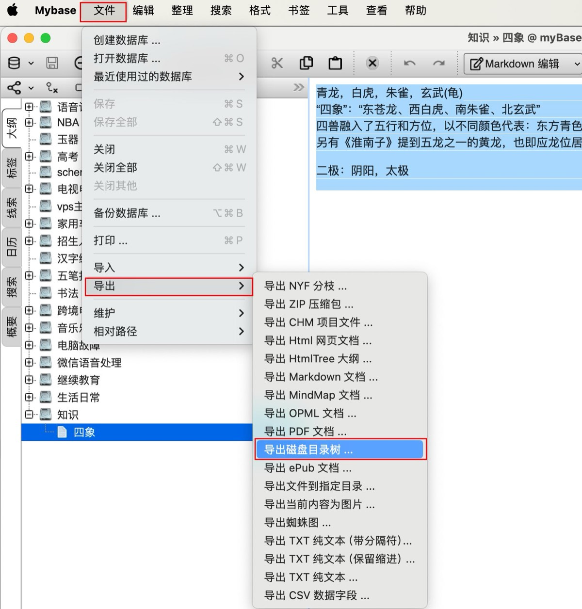
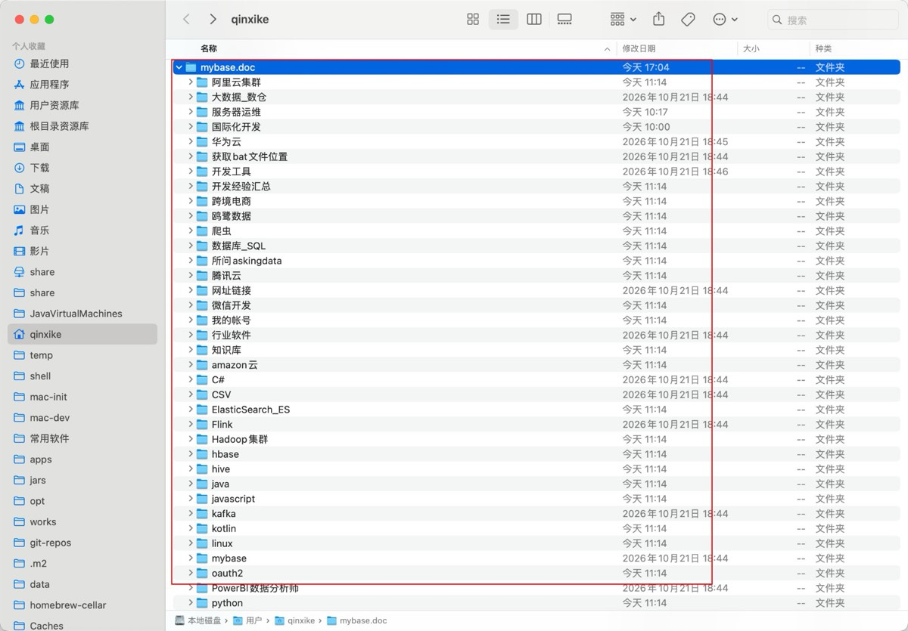
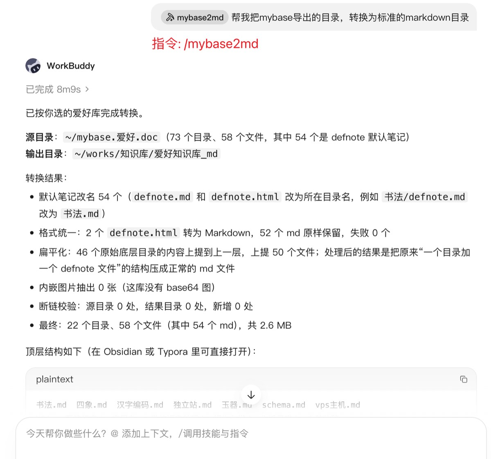
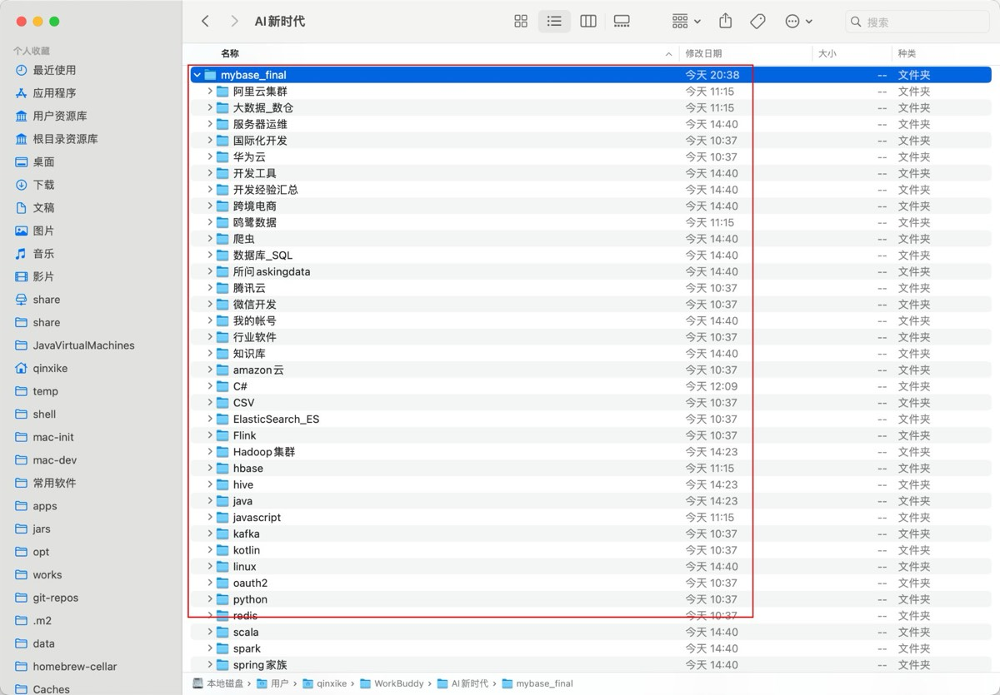

# mybase2md 操作说明文档

> 把 mybase（云橙笔记/myBase）导出的「磁盘目录树」整理成标准 Markdown 笔记库（Obsidian / Typora 均可直接使用）。

## 一、mybase 导出格式的特点

使用 mybase 的「文件 → 导出 → 导出磁盘目录树」功能后，得到这样的目录结构：

- 每个文件夹下可能有 `defnote.md`、`defnote.txt`、`defnote.html` 或 `defnote.qrich.html` 文件，对应 mybase 中 4 种笔记内容类型：
  - `defnote.md` —— Markdown 笔记
  - `defnote.txt` —— 纯文本笔记
  - `defnote.html` —— HTML 笔记
  - `defnote.qrich.html` —— 富文本笔记（本质也是 HTML）
  - 原因：mybase 中**文件夹本身也可以写笔记**，内容就记录在这些默认名称的文件里
- 笔记的附件（图片等）导出在同目录下
- 「一篇笔记」在磁盘上表现为：一个目录 + 一个默认名笔记文件 + n 个图片附件，笔记标题就是目录名

## 二、工具亮点

- **一键到底**：改名 → 格式统一 → 扁平化 → 校验，给出路径就跑完，**默认直接执行**；想先看计划时加 `--dry-run` 预演
- **环境自检弹窗**：运行前自动检查 Python 版本（需 3.7+）和依赖库，缺什么就弹窗说明并给出安装命令，装完点「确定」自动复查，不用翻文档找依赖
- **跨平台弹窗选目录**：macOS 弹原生对话框、Windows 用 tkinter 弹窗，选源目录和输出位置点几下鼠标即可，无需手输路径
- **源目录零改动**：全程只读源目录，所有输出写入新目录；「删除底层目录」通过「不在结果中创建」实现，等价却零风险
- **HTML 内嵌图片自动解码**：网页式 HTML 笔记中 base64 编码的图片（文件里根本没有独立图片文件）自动解码保存为 `<笔记名>_img<N>.png`，并在 md 中生成相对路径引用，笔记内容零丢失
- **懒加载占位图智能处理**：网页抓取型笔记里大量 130 字节的空 SVG 占位图，自动改用页面里记录的真实图片外链，不留坏引用
- **隐藏目录/文件自动过滤**：`.obsidian`、`.git`、`.DS_Store` 等点号开头的目录和文件默认全部排除，可用 `--include-hidden` 改变行为
- **同名文件自动去重**：内容完全相同的重复文件（笔记比文本、附件比 MD5）只保留一份
- **同名冲突自动改名**：内容不同的撞名文件自动命名为 `原名（来源目录）.ext`，且考虑 macOS 大小写不敏感特性（`Shell编程基础.md` 与 `shell编程基础.md` 视为撞名）；笔记改名后其抽出的图片名也跟随保持一致
- **断链审计报告**：自动区分「源文件本来就断」和「转换后新增」两类图片断链，零新增才算通过，转换质量可验证
- **中文编码兼容**：自动识别 UTF-8（含 BOM）/ GB18030，老笔记不乱码
- **生成 JSON 校验报告**：改名清单、冲突记录、去重清单、断链明细一目了然

## 三、完整使用流程：从 myBase 导出到产出结果

整个流程分 4 步：**myBase 导出 → 得到导出目录 → AI 对话/命令行调用 → 查看结果**。

### 第 1 步：在 myBase 中导出磁盘目录树

打开 myBase，选中要导出的知识库（或某个分支），菜单栏依次点击：

**文件 → 导出 → 导出磁盘目录树 ...**

然后选择一个保存位置（例如 `~/mybase.doc`），等待导出完成。



### 第 2 步：查看导出结果

导出完成后得到一个普通文件夹（如 `~/mybase.doc`），里面就是上面「一」描述的结构：目录套目录，每个目录下可能有 `defnote.*` 笔记文件和图片附件。**这个目录就是本工具的输入**，全程只读不会被修改。



### 第 3 步：在 AI 对话中完成转换（WorkBuddy 示例）

装好本技能后，**不需要自己敲命令**，在 AI 对话里说一句话即可。三种调用方式任选：

1. **斜杠指令**：输入框输入 `/mybase2md`，后面跟上需求，例如
   > `/mybase2md 帮我把mybase导出的目录，转换为标准的markdown目录`
2. **@ 技能**：输入 `@` 选择 mybase2md，再描述需求
3. **纯口语**：直接说「帮我把 ~/mybase.doc 转换成标准 markdown 笔记库，输出到 ~/mybase_new」



**环境自检**：转换开始前，脚本会自动检查本机的 **Python 版本（需 3.7+）** 和依赖库（`beautifulsoup4` / `markdownify` / `lxml`）是否就绪；缺失时**弹窗提示**并附上安装命令，安装完成后点「确定」自动复查，通过后继续转换，下次调用前也会再检查。

> 注意：**Windows 默认不安装 Python**。如果本机没有 Python，脚本根本无法运行，AI 会先提示你安装：到 https://www.python.org/downloads/ 下载安装（勾选 “Add Python to PATH”），或用 Microsoft Store 搜 Python 安装，装完后重新发起转换即可。

**不想手输路径？** 说「用弹窗选目录」，或不给路径直接发起转换，AI 会运行脚本加 `--pick` 参数，弹出系统原生文件夹选择框（**macOS 和 Windows 均支持**）：

1. 选择 mybase 导出的**源目录**（如 `mybase.doc`）
2. 选择输出位置的**父文件夹**
3. 输入**输出文件夹名称**（默认 `mybase_md`）

点几下鼠标即可，不用手动输入完整路径。

**AI 的执行流程**：

1. **直接执行**（默认行为）：AI 运行脚本，一次性完成改名、转 md、扁平化、校验，把结果汇报给你——多少文件、改名多少、转换多少、有无冲突和断链
2. **需要先看计划时**：让 AI 加 `--dry-run`，此时只统计不写任何文件，你确认后再正式跑
3. **汇报结果**：执行完把 JSON 报告的关键数字（文件数守恒、断链零新增等）解读给你
4. **后续处理**：你审核满意后，用新目录替换旧目录即可；不满意随时可让 AI 调整参数重跑

> 输出目录必须是**不存在或为空**的，所以「直接执行」不会覆盖你已有的笔记库；目标已存在时会报错，需要显式加 `--force` 才会清空重来。

**其他 AI 工具怎么用**：任何支持「技能/Skill」机制（即能读取 `SKILL.md` 并执行脚本）的 AI 工具都可以这样用：

1. 把技能包安装到该工具的技能目录（或按其规范导入）
2. 在对话中用自然语言触发，例如：「用 mybase2md 把 /path/to/mybase.doc 转换到 /path/to/output」
3. AI 会读取 `SKILL.md` 里的工作流说明，调用 `scripts/mybase2md.py`（默认直接执行，需要预览时加 `--dry-run`）

如果 AI 工具不支持技能机制，直接让它执行下面这条命令也一样（脚本自身带完整说明）：

```bash
python3 scripts/mybase2md.py ~/mybase.doc ~/mybase_new
```

### 第 4 步：查看转换结果

转换完成后得到一个全新的标准 Markdown 笔记库：每个笔记一个同名 `.md` 文件、图片附件保留在同目录、目录层级已扁平化，可直接用 Obsidian / Typora 打开使用。



## 四、整理目标

1. **重命名**：`defnote.*` → 「所在目录名 + 原后缀」（笔记名即目录名）
2. **统一格式**：全部转为 `.md`
   - `.txt` 直接改后缀
   - `.html`（含 `.qrich.html`）转换为 Markdown
3. **扁平化**：底层目录（一篇笔记的目录壳）中的文件上提到父目录，不再保留该目录
4. **校验**：对比源目录与结果目录，确认文件数量守恒、图片引用断链无新增

## 五、快速开始

### 0. 准备环境（只需一次）

**① Python 3.7 及以上**

macOS / Linux 一般自带；**Windows 默认没有 Python**，需要先安装：

1. 打开 https://www.python.org/downloads/ 下载安装包（或 Microsoft Store 搜 Python 安装）
2. 安装时**务必勾选 “Add Python to PATH”**
3. 打开命令提示符验证：`python --version`（macOS/Linux 用 `python3 --version`）

> 脚本启动时会自动检查 Python 版本，过低会弹窗提示并给出下载地址。

**② 依赖库**

```bash
pip3 install --user beautifulsoup4 lxml markdownify     # macOS / Linux
pip install beautifulsoup4 lxml markdownify             # Windows
```

> 不确定装没装也没关系：脚本每次运行都会自动检查，缺哪个会**弹窗提示**并给出对应平台的安装命令，装完点「确定」立即复查。

### 1. 直接执行（默认）

```bash
python3 scripts/mybase2md.py ~/mybase.doc ~/mybase_new
```

默认就会真正写盘，输出目录必须是**不存在或为空**的目录。

### 2. 想先看计划：加 --dry-run

```bash
python3 scripts/mybase2md.py ~/mybase.doc ~/mybase_new --dry-run
```

会输出：目录/文件总数、待改名数量、html/txt 转换数量、将展开的底层目录数、同名冲突处理方式、断链统计，**不写任何文件**。

### 3. 查看报告

执行完成后自动生成 `<目标目录>_report.json`，包含：改名清单、冲突处理记录、去重清单、断链明细（源 vs 结果）、错误列表。

## 六、完整参数说明

| 参数 | 说明 |
|---|---|
| `SRC` | mybase 导出的目录，例如 `~/mybase.doc`；省略时弹窗选择 |
| `DST` | 输出目录，必须不存在或为空；省略时弹窗选择 |
| `--pick` | 弹出文件夹选择框交互选择源目录和输出位置（macOS 原生 / Windows tkinter；弹窗均不可用时自动退回终端输入） |
| `--dry-run` | 只演练不写盘（**默认直接执行**，需要预演时加此参数） |
| `--apply` | 兼容旧用法：默认已执行，此参数可省略 |
| `--force` | 目标目录非空时先清空再执行 |
| `--no-flatten` | 跳过扁平化，保留目录层级 |
| `--no-convert` | 跳过格式转换，只做改名 |
| `--include-hidden` | 连同点号开头的隐藏目录/文件一起处理（默认全部过滤） |
| `--report PATH` | 指定校验报告 JSON 的输出路径 |
| `--sample N` | 演练时列出前 N 条输出计划（默认 15） |
| `--quiet` | 只输出汇总 |

## 七、转换细节说明

### HTML → Markdown

- 外部图片引用**原样保留**（同目录相对文件名不变，附件一并复制到输出目录）
- **base64 内嵌图片**自动解码，保存为同目录的 `<笔记名>_img1.png` 等文件，并在 md 中生成相对路径引用
- 网页懒加载占位图（130 字节左右的空 SVG 壳）自动改用 `data-src` 里的真实图片外链
- 表格转 Markdown 表格、代码块还原为围栏代码块（支持 `brush: java` 等语言标记）、清理 Word 式内联样式、空标题、`<br>` 噪声
- 编码兼容：自动尝试 UTF-8（含 BOM）/ GB18030

### 扁平化规则（重要）

- 只展开**原始底层目录**（处理前没有子目录的目录）
- 因底层目录被展开而**被动**变成底层的上级目录保持不动
- 脚本用处理前的一次性快照做判定，天然满足上述规则

### 同名冲突处理

macOS 文件系统大小写不敏感，因此冲突检测统一按 casefold 比较（`Shell编程基础.md` 与 `shell编程基础.md` 视为撞名）：

- 内容完全相同（笔记比文本、附件比 MD5）→ 只保留一份
- 内容不同 → 保留一份原名，其余命名为 `原名（来源目录）.ext`，仍冲突则加 `-2`

### 安全设计

- **源目录全程只读**：脚本从不修改、移动、删除源目录里的任何文件
- 所谓「转移文件、删除底层目录」，实现为「复制到目标目录时不再创建该目录」，结果与原地搬移完全等价，但没有不可逆风险
- 目标目录非空时拒绝执行，除非显式加 `--force`

## 八、校验结果怎么读

| 报告字段 | 含义 |
|---|---|
| `stage1_rename` | 改名的文件数与分类统计 |
| `stage2_convert` | html/txt/md 数量、成功/失败数、抽出内嵌图片数 |
| `stage3_flatten` | 原始底层目录数、空目录数、展开数、上提文件数 |
| `conflicts` | 因冲突改名的文件（原名→新名）与被去重的文件 |
| `links.src_broken` / `dst_broken` | 源目录与结果目录的图片断链数，`src_broken_list` 与 `dst_broken_list` 一一对应即为零新增 |

**断链排查建议**：若结果目录出现源目录没有的断链，检查该笔记是否引用了带空格/特殊字符的文件名；若源目录本身有断链，多为 mybase 当年导出时未导出对应附件，需手动补图或删除引用。

## 九、常见问题

**Q：会修改我的原始导出目录吗？**
不会。源目录全程只读，所有输出写入新目录。

**Q：隐藏目录（如 `.obsidian`、`.git`）会被处理吗？**
不会。所有点号开头的隐藏目录和文件默认整体过滤，不出现在结果中；确实需要保留时加 `--include-hidden`。

**Q：非 defnote 的 `.txt` / `.html` 文件也会转 md 吗？**
会。脚本按后缀统一处理；如需保留某些文件原样，可先移出源目录。

**Q：Windows 电脑能用吗？**
能。转换脚本是纯 Python 跨平台的；弹窗选目录在 Windows 上用 tkinter 实现（弹窗不可用时退回命令行输入路径）。注意 Windows 下路径用反斜杠或正斜杠均可，例如 `python mybase2md.py C:\mybase.doc D:\mybase_new`。

**Q：Windows 上提示找不到 python / python3 命令？**
Windows 默认不安装 Python。请到 https://www.python.org/downloads/ 下载安装，**安装时勾选 “Add Python to PATH”**（或用 Microsoft Store 搜 Python 安装），然后重开命令行，用 `python --version` 确认能看到版本号。

**Q：不加 `--apply` 会真的写盘吗？会不会误操作？**
会真的写盘——默认行为就是直接执行。想先看计划请加 `--dry-run`。另外输出目录必须是**不存在或为空**的目录，已有内容时脚本会拒绝执行（除非显式加 `--force` 并会先清空），所以不会悄悄覆盖你已有的笔记库。

**Q：提示缺少依赖库怎么办？**
脚本运行时会自动检查，缺失时弹窗给出安装命令（Windows：`pip install beautifulsoup4 lxml markdownify`；macOS/Linux：`pip3 install --user beautifulsoup4 lxml markdownify`）。装完点弹窗「确定」立即复查；也可以先退出，装好后下次运行自动再检查。

**Q：转换失败的文件怎么办？**
脚本会跳过并在报告中记录错误原因，其余文件正常处理，最后汇总提示。

**Q：跑一次要多久？**
1000+ 文件、240+ 个 HTML 的库约 1 分钟（含内嵌图片解码）。
